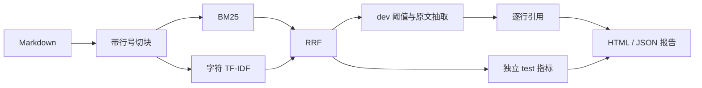

# Evidence RAG

**可追溯的双语文档检索与评测工具。** 支持 BM25、字符 TF-IDF 与 RRF 融合，返回原文片段和来源行号，并独立评估检索排序与拒答决策。


适用于 Markdown 知识库的检索基线比较、引用溯源和查询集回归。索引、检索和报告生成均在本地执行；回答模式为 `offline-extractive`，直接返回原文片段。字符 TF-IDF 是稀疏词法特征，当前版本不包含语义 embedding、神经重排或生成模型。

## 快速开始

```bash
git clone https://github.com/cl-user-blip/evidence-rag.git
cd evidence-rag
python -m venv .venv
# Windows PowerShell: .venv\Scripts\Activate.ps1
# macOS / Linux: source .venv/bin/activate
python -m pip install -e ".[dev]"
python -m evidence_rag evaluate --output outputs
python -m evidence_rag query "How does reciprocal rank fusion combine retrieval rankings?"
python -m pytest
```

直接用浏览器打开 `outputs/report.html`；里面可以展开全部 RRF 测试问题，看源文档、真实片段、分路分数和误拒／误接收。GitHub 文件页不直接渲染 HTML：可下载已生成的 [examples/report.html](examples/report.html) 后打开，或本地运行上面的命令。[完整机器可读结果](examples/metrics.json) 也已提交。

没有 API Key、付费模型调用或外部语料下载；内置资料为本项目原创。安装 Python 依赖需要网络。

## 评测结果

以下来自提交的 `examples/metrics.json`，环境 Python 3.14.6、NumPy 2.4.6、scikit-learn 1.9.0。

| 排序方法 | Recall@3 ↑ | MRR@3 ↑ | nDCG@3 ↑ | 拒答 balanced accuracy ↑ | 未知问题误接收率 ↓ |
| --- | ---: | ---: | ---: | ---: | ---: |
| BM25 | 0.933 | 0.967 | 0.924 | 0.667 | 0.667 |
| Character TF-IDF | 0.933 | 0.933 | 0.899 | 0.550 | 0.500 |
| RRF | 0.933 | 0.967 | 0.924 | 0.550 | 0.500 |

实验规模：12 篇原创双语资料、25 个切块；12 个 dev 问题；21 个 test 问题，其中 15 个有答案、6 个无答案。`@3` 指去重后的前三个**不同文档**。无答案问题不参与排序指标的平均，另参与拒答混淆矩阵。

**RRF 在这组问题上没有超过 BM25；高 recall 也没有解决拒答。** RRF 对 6 个无答案问题误接收了 3 个，对 15 个有答案问题误拒了 6 个。比如“checkpoint 数据库密码是什么？”会命中讲 checkpoint 的资料，相似度很高，但语料没有密码。这正是检索相似度与事实支持之间的差别。报告保留了所有逐题结果。

阈值分别按每个方法的 dev balanced accuracy、F1、更高阈值的顺序选择，test 不参与阈值选择。默认 CLI query 使用配置值 `0.16`；复现当前 RRF 评测的决策可传 `--threshold 0.1679944167`。这个分数是余弦相似度启发值，**不是置信概率**。

这套自建语料和 qrels 用于小规模回归，dev/test 属于同一资料范围；不是独立公开基准或生产 A/B 测试。切块预算固定为 320 字符，没有进行 chunk-size 超参数搜索。在其他领域使用时，应建立独立的查询集重新评估。

## 功能与架构

- **可追溯切块**：UTF-8 Markdown → 有界长度切块 → 相对路径、原始行号、内容相关稳定 ID；支持单行超长内容和重叠，忽略语料根外的符号链接。
- **可解释检索**：英文词项 + 中文二元字串 BM25、2–4 字符 TF-IDF、固定深度 RRF；保留每路分数，避免直接混加不同量纲。
- **可检查证据**：输出原文片段和 `file.md:Lx-Ly` 引用；报告中不把“引用存在”当成“答案正确”。
- **可复现评测**：dev 选阈值、test 报告排序与拒答；记录语料摘要、问题摘要、版本和配置。测试会修改 test 标签并验证 dev 阈值不变。
- **离线报告**：不依赖 CDN 的独立 HTML 报告、JSON 原始结果与 SVG 预览。



## 换成自己的资料

```bash
python -m evidence_rag ingest ./my-docs --output outputs/chunks.json
python -m evidence_rag query "你的问题" --corpus ./my-docs --method rrf --json
python -m evidence_rag evaluate --corpus ./my-docs --queries ./queries.json --output outputs/my-data
```

自定义 `queries.json` 格式如下；正式评测应包含 dev/test，dev 同时包含有答案与无答案问题，所有相关文件路径相对语料根目录。不要把公司的私密资料提交到公开仓库。

```json
[
  {"id":"dev-1","split":"dev","query":"相关问题","relevant":["guide.md"]},
  {"id":"dev-2","split":"dev","query":"资料没覆盖的问题","relevant":[]},
  {"id":"test-1","split":"test","query":"另一个相关问题","relevant":["guide.md"]}
]
```

修改 chunk 长度可加 `--max-chars 240`；检索指标的 `--top-k` 表示不同文档数，query 的 `--top-k` 表示返回候选切块数。用自己的语料时应重新在 dev 选阈值，不能直接套用演示资料的数值。

## 开发与测试

```bash
python -m pytest
python -m evidence_rag evaluate --output outputs/regression
python scripts/render_preview.py
```

测试覆盖引用行号、空文件与超长行、RRF 排名、文档去重、指标计算以及 test 标签不影响 dev 阈值等边界。本地验证结果为 18 项通过、1 项因 Windows 符号链接权限跳过。预览脚本从已经提交的 `examples/metrics.json` 生成 SVG；它不会自动运行新的评测。

```text
evidence_rag/
  ingest.py       Markdown 切块与来源记录
  retrieval.py    BM25、TF-IDF、RRF
  answer.py       拒答阈值与原文抽取
  evaluate.py     dev/test 协议与指标
  report.py       HTML 和 JSON 报告
  data/           内置回归语料与查询标签
tests/            检索、引用与评测回归
examples/         已生成的评测产物
```

[使用与数据格式](docs/usage.md) · [设计、复杂度与评测口径](docs/design.md)

## 当前限制

- 索引驻留内存；BM25 按查询词项扫描切块，适用于小型语料和基线实验。
- 引用能定位原文，但不验证片段是否蕴含答案；相近主题的未知问题容易被误接收。
- 未实现持久索引、增量更新、文档权限过滤和在线服务。扩展数据规模前，需要补充这些能力并进行压力测试。

## 参考

- [scikit-learn TfidfVectorizer 官方文档](https://scikit-learn.org/stable/modules/generated/sklearn.feature_extraction.text.TfidfVectorizer.html)：字符分析器、n-gram 和 L2 归一化。
- [Cormack, Clarke & Büttcher, SIGIR 2009 作者版本](https://cormack.uwaterloo.ca/cormack/cormacksigir09-rrf.pdf)：RRF 方法。论文中的效果不代表本项目实验结果。
- [Robertson & Zaragoza, 2009](https://doi.org/10.1561/1500000019)：BM25 与概率相关框架。

MIT License。语料为原创工程教学材料，包含简化策略与明确的实验边界。
